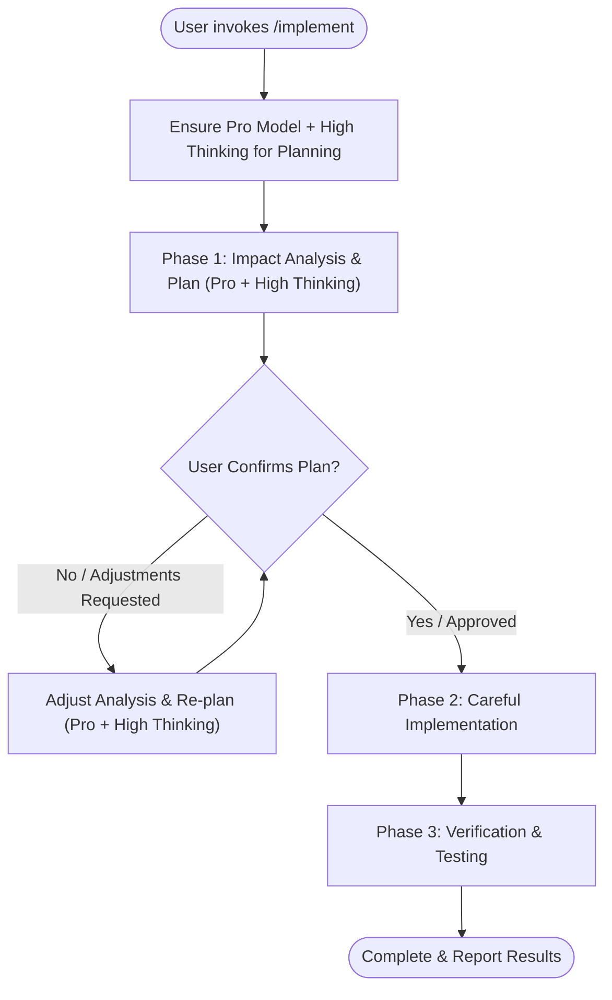
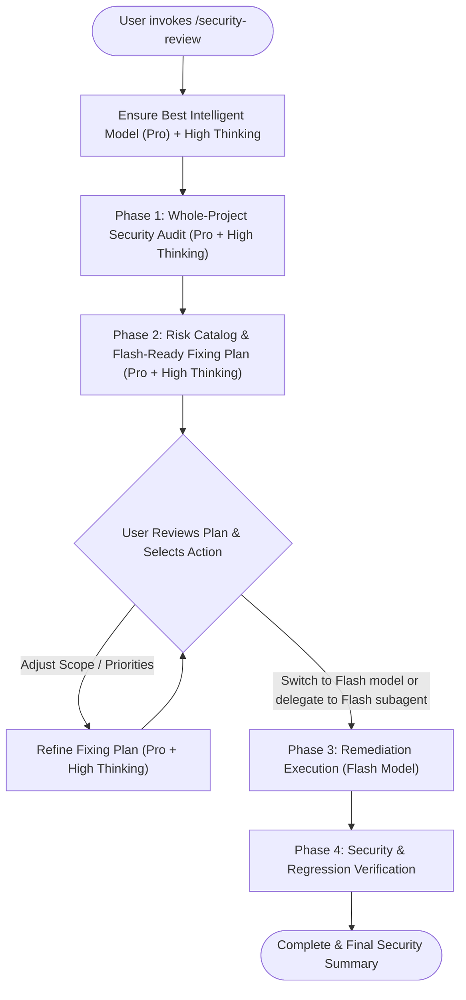

# Agent Skills

A curated repository of high-impact, battle-tested skills for **Google Antigravity**, **Claude Code**, and autonomous AI coding agents.

---

## Included Skills

| Skill | Slash Command | Model Strategy | Description |
| :--- | :--- | :--- | :--- |
| [**implement**](./skills/implement/SKILL.md) | `/implement` | **Pro (High Thinking)** $\rightarrow$ **Execution** | Executes a rigorous 3-phase implementation workflow: system-wide impact analysis & planning with deep reasoning, explicit user confirmation gate, careful implementation, and automated test verification. |
| [**security-review**](./skills/security-review/SKILL.md) | `/security-review` | **Pro (High Thinking)** $\rightarrow$ **Flash Execution** | Two-tier security audit and remediation workflow: deep whole-project security audit across 6 domains, deterministic fixing plan, cost-effective remediation via Flash, and regression testing. |

---

## Skill Overviews

### 1. `/implement` — Rigorous Implementation Workflow

Prevents breaking changes, hallucinated architectures, and untested code modifications by enforcing a strict 3-phase engineering gate:



#### Key Highlights:
- **Phase 1 (Impact Analysis & Planning)**: Exhaustive analysis across call graphs, database schemas, brokers, external APIs, and contract consumers using deep reasoning (**Pro + High thinking**).
- **Mandatory Approval Gate**: Strictly halts execution and requests user sign-off before modifying any source code.
- **Phase 2 (Careful Implementation)**: Targeted, defensive code modifications preserving existing docstrings, style, and comments.
- **Phase 3 (Automated Verification)**: Validates compilation, unit/integration test suites, and lint checks.

---

### 2. `/security-review` — Whole-Project Security Audit & Remediation

Systematic vulnerability discovery and remediation designed around a two-tier model approach:



#### Audited Domains:
1. **Secrets & Configurations**: Hardcoded credentials, insecure defaults, environment leakages.
2. **Authentication (AuthN)**: Token signing algorithms, session fixation, timing attack vectors, brute-force controls.
3. **Authorization (AuthZ)**: Broken Object Level Authorization (BOLA/IDOR), missing role gates, header spoofing.
4. **Injection & Input Validation**: Source-to-sink taint tracking for SQLi, Command Injection, XSS, SSRF, path traversal.
5. **Cryptography & Data Privacy**: Non-cryptographic PRNG usage, weak hashes, sensitive PII logging.
6. **Infrastructure & CI/CD**: Container security, Dockerfile privileges, dependency vulnerabilities, GitHub Actions workflow risks.

---

## Installation

### Google Antigravity

#### Global Installation (Available across all workspaces)
Copy the skills into your global Antigravity config directory:

```bash
# Clone the repository
git clone https://github.com/lovelytee/agent-skills.git

# Copy skills to global config
mkdir -p ~/.gemini/config/skills
cp -r agent-skills/skills/* ~/.gemini/config/skills/
```

#### Workspace Installation (Project-specific)
Add the skills directly to your project's `.agents/` folder:

```bash
mkdir -p .agents/skills
cp -r agent-skills/skills/* .agents/skills/
```

---

## License

[MIT](./LICENSE) © [Teerawut Tajurainan](https://github.com/lovelytee)
