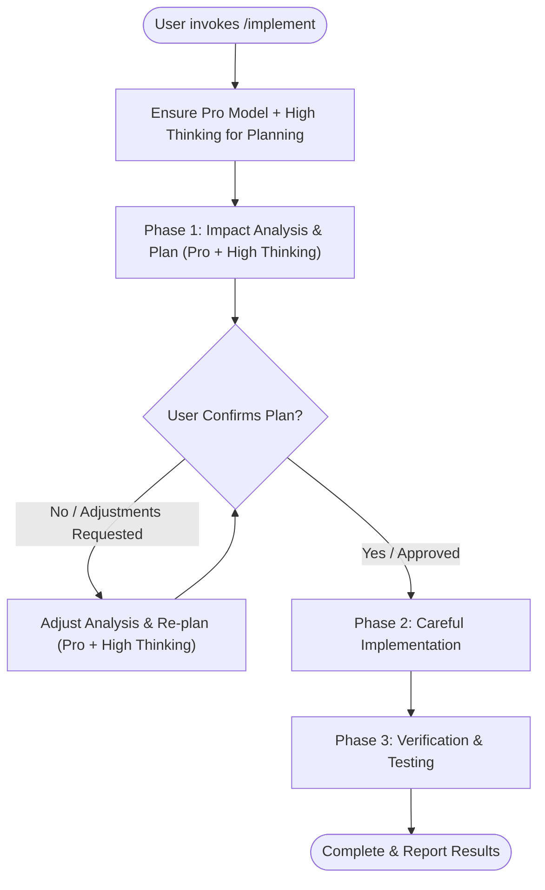

# Implement Workflow (`/implement`)

This skill defines the standard procedure for implementing features, refactors, or bug fixes with end-to-end impact analysis and planning powered by the **Pro model + High thinking**, explicit user confirmation gates, careful code modification, and automated test verification.

---

## Model & Thinking Requirements for Planning

> [!IMPORTANT]
> **Phase 1 (System-Wide Impact Analysis & Planning) MUST use the `Pro` model with `High` thinking:**
> - **Deep Reasoning Mode**: Perform exhaustive, high-effort reasoning across all architectural layers, cross-service dependencies, database schemas, and edge cases when analyzing impact and designing the implementation plan.
> - **Model Enforcement**:
>   - If the user has not already selected the **Pro** model with **High** thinking in the UI, explicitly recommend switching to **Pro (High)** for the planning phase, **OR** immediately delegate Phase 1 to a `self` subagent using `invoke_subagent` with `Model: "pro"` and explicit instructions to perform deep, high-effort analysis and planning.
>   - Any re-planning or adjustments requested during the confirmation gate must also use **Pro + High thinking**.

---

## Working Procedure

### Phase 1: System-Wide Impact Analysis & Planning (Pro Model + High Thinking)

1. **Analyze the Entire Project Codebase**:
   - Trace all layers of the architecture affected by the proposed change (e.g., Database migrations, Models, Repositories, Domain Services, HTTP/gRPC Handlers, Routers, and Configurations).
   - Check existing unit tests and integration tests covering the affected areas.

2. **Analyze External System Impact**:
   - **Database & Storage**: Schema migrations, column additions/removals, indexes, triggers, constraints, and backward compatibility with existing environments.
   - **Caching & Brokers**: Cache invalidation (e.g., Redis/Valkey), message brokers (e.g., Kafka/RabbitMQ), and TTLs.
   - **Upstream & Downstream Services**: API contracts, HTTP headers (e.g., `User-Id`), query parameters, payloads, error responses, and status codes.
   - **Clients & Consumers**: Mobile apps, web frontends, and external third-party integrations consuming the changed endpoints.

3. **Formulate a Structured Implementation Plan**:
   - **Scope & Objective**: Clear summary of what will be changed.
   - **Impact Assessment**: Table of affected files, functions, contracts, and external systems.
   - **Step-by-Step Execution Plan**: Ordered list of files to edit and specific code adjustments (detailed enough that any model can execute Phase 2 deterministically).
   - **Database Migration Strategy**: Migration SQL scripts or notes for running instances.
   - **Testing Strategy**: Specific test suites and test cases to run or write.

4. **Mandatory User Confirmation Gate**:
   > [!IMPORTANT]
   > **DO NOT start modifying code before receiving explicit user approval.**
   > Present the complete plan to the user and pause.
   > If the user requests modifications or adjustments, update the plan using **Pro + High thinking** and **reconfirm again** until full alignment is reached.

---

### Phase 2: Careful Implementation

Once the plan is explicitly approved by the user:

1. **Execute Step-by-Step**:
   - Apply edits strictly following the agreed plan.
   - Keep changes minimal, focused, and cohesive.

2. **Code Quality & Safety Standards**:
   - Preserve existing comments, docstrings, and unrelated functionality.
   - Follow idiomatic project style and naming conventions.
   - Handle all edge cases, errors, and nil/null checks defensively.
   - Ensure backward compatibility where external consumers depend on contracts.

---

### Phase 3: Verification & Automated Testing

Immediately after code changes are made:

1. **Compile & Build Check**:
   - Verify that the project builds cleanly without compilation or syntax errors.

2. **Run Test Suites**:
   - Run unit and integration tests across the workspace (e.g., `go test ./...` or project equivalent).
   - Ensure all affected packages pass.

3. **Update & Add Tests**:
   - Update mocks and test expectations to match new signatures or behaviors.
   - Add new test cases covering edge cases, success paths, and failure scenarios.

4. **Address Failures Promptly**:
   - If tests or linters fail, diagnose and resolve the failures before completing the turn.

5. **Final Reporting**:
   - Provide a concise summary of the changes made, test results, and any relevant next steps or deployment notes.
