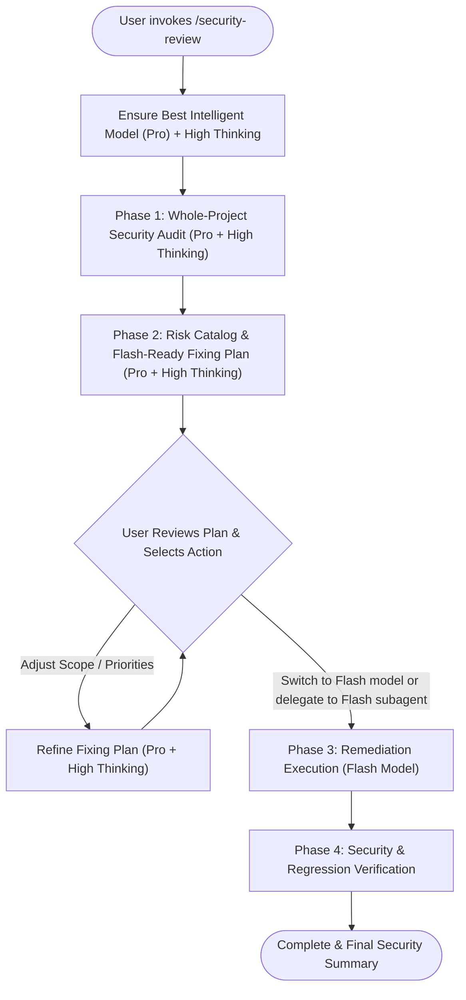

# Security Review Workflow (`/security-review`)

This skill defines a two-tier model workflow for project-wide security auditing and remediation:
1. **Audit & Planning Tier (Best Intelligent Model + High Thinking)**: Phase 1 (Whole-Project Security Audit) and Phase 2 (Risk Catalog & Fixing Plan) require maximum reasoning depth to uncover subtle architectural, authentication, authorization, and injection vulnerabilities and design safe, non-breaking fixes.
2. **Execution Tier (Flash Model)**: Phase 3 (Remediation Execution) uses the fast, cost-effective **Flash** model following the deterministic, self-contained Fixing Plan generated in Phase 2.

---

## Model & Thinking Requirements

> [!IMPORTANT]
> **Phase 1 (Whole-Project Security Audit) & Phase 2 (Fixing Plan) MUST use the Best Intelligent Model (`pro` / highest capability model) with High Thinking:**
> - **Deep Reasoning Mode**: Perform exhaustive, high-effort analysis across call graphs, data flows (source-to-sink taint tracking), middleware chains, and trust boundaries before writing findings.
> - **Model Enforcement**:
>   - If the user has not already selected the top-tier intelligent model with **High** thinking in the UI, explicitly recommend setting **Model Selection** to the best intelligent model (with **High** thinking) for the audit, **OR** immediately delegate Phase 1 & Phase 2 to a `self` subagent using `invoke_subagent` with `Model: "pro"` and explicit instructions to perform deep, high-effort reasoning.
>   - Never take shortcuts or perform shallow keyword-only scans during Phase 1 and Phase 2.

---

## Working Procedure

### Phase 1: Whole-Project Security Audit (Best Intelligent Model + High Thinking)

#### A. Efficiency Strategy: Two-Pass Targeted Discovery & Parallel Scaling
1. **Exclude Noise Immediately**: Skip generated, vendor, and build directories (`node_modules/`, `vendor/`, `dist/`, `build/`, `.git/`, `*_mock.go`, `*.pb.go`).
2. **Pass 1 — Fast Attack-Surface Mapping**:
   - Use `find_by_name` and targeted `grep_search` calls to quickly locate entrypoints (routers, HTTP/gRPC handlers, middleware), data sinks (SQL/NoSQL queries, `exec`/shell calls, file I/O, HTTP clients), and config/deployment files (`.env*`, `Dockerfile`, CI workflows, `go.mod`/`package.json`).
   - Where available, run fast read-only local dependency/security analyzers (e.g., `govulncheck`, `npm audit`, `pip-audit`).
3. **Pass 2 — Deep Source-to-Sink Inspection**:
   - View only the relevant line slices (`StartLine`–`EndLine`) along untrusted input paths rather than reading entire large files indiscriminately.
   - **Monorepo / Large Project Scaling**: If the project contains multiple services or >50 source files, partition the discovery across parallel `research` subagents (e.g., by service or domain) and synthesize their findings using the `Pro + High` model.
4. **Evidence Verification (False-Positive Filter)**:
   - Verify whether an untrusted source actually reaches the sink without sanitization before reporting it. Clearly distinguish confirmed vulnerabilities from defense-in-depth hardening recommendations.

#### B. Security Audit Domains
Scan and audit the repository systematically across all 6 domains:

1. **Secrets, Credentials & Configuration**:
   - Hardcoded API keys, tokens, passwords, private keys, or connection strings in source code, config files, `.env` templates, scripts, or tests.
   - Insecure defaults (e.g., debug mode enabled, weak default secrets, permissive CORS `*`, missing TLS enforcement).
   - Gitignore coverage for sensitive files.

2. **Authentication & Session Management (AuthN)**:
   - Token generation, signing algorithms, expiration, and validation (e.g., JWT `alg: none` or weak secrets, missing claims validation).
   - Password hashing (e.g., bcrypt/argon2 vs. weak hashes), brute-force protection, and rate limiting on auth endpoints.
   - Session fixation, insecure cookie flags (`HttpOnly`, `Secure`, `SameSite`).

3. **Authorization & Access Control (AuthZ)**:
   - Broken Object Level Authorization (BOLA / IDOR) — trace handlers through services to repositories to verify ownership or tenant/organization checks on resource IDs.
   - Broken Function Level Authorization — verify role/permission middleware attachment across all routes and administrative/mutating endpoints.
   - Trusting client-supplied headers (e.g., `User-Id`, `X-Forwarded-For`, role headers) without gateway/token verification.

4. **Injection & Input Handling (Source-to-Sink Taint Analysis)**:
   - SQL / NoSQL Injection (raw string concatenation, dynamic `ORDER BY`/`WHERE` clauses, or unparameterized queries).
   - Command Injection (`exec`, `spawn`, `os/exec`, shell interpolation with untrusted input).
   - Cross-Site Scripting (XSS), Server-Side Request Forgery (SSRF), Path Traversal / Local File Inclusion, and XML/Template Injection.
   - Missing request payload validation, unbounded input sizes, race conditions (TOCTOU), or mass assignment vulnerabilities.

5. **Cryptography, Data Protection & Privacy**:
   - Weak cryptographic algorithms (MD5, SHA1, DES, ECB mode) or non-cryptographic PRNG (`math/rand`, `Math.random()`) used for security-sensitive contexts.
   - Sensitive data exposure (PII, credentials, tokens, stack traces) in logs, error responses, or telemetry.

6. **Dependencies, Infrastructure & CI/CD**:
   - Known vulnerable dependencies (`go.mod`, `package.json`, `requirements.txt`, etc.).
   - Container security (`Dockerfile` running as `root`, unpinned base images, secrets baked into layers).
   - CI/CD workflows (script injection, overly broad permissions, unpinned third-party actions).

---

### Phase 2: Risk Report & Flash-Ready Fixing Plan (Best Intelligent Model + High Thinking)

Present a clear, comprehensive report and persist it as an artifact (`security_review_plan.md` in the artifact directory, or in-chat summary with artifact link) containing:

1. **Safety Rule — Mandatory Secret Redaction**:
   > [!CAUTION]
   > **NEVER echo raw secrets, private keys, passwords, or live tokens into the chat response or artifact files.**
   > Always redact secret values (e.g., `sk-live-****REDACTED****`) and reference them strictly by **file path and line number** so sensitive credentials are never leaked into transcripts or artifacts.

2. **Executive Summary**:
   - Overview of project architecture, audited components, and total findings count by severity (`Critical`, `High`, `Medium`, `Low`, `Informational`).

3. **Detailed Risk Catalog**:
   For every identified risk, provide:
   - **ID & Title**: e.g., `[SEC-01] SQL Injection in User Search Repository`
   - **Severity & Category**: `Critical` | `High` | `Medium` | `Low` | `Info` (with CWE/OWASP category)
   - **Compatibility & Operational Impact**:
     - `Safe (Drop-in)`: Internal code fix with zero external API or config breakage.
     - `Config Required`: Requires adding/rotating environment variables or secrets before deployment.
     - `Breaking Change Risk`: Alters HTTP status codes, auth headers, CORS rules, or payload schemas consumed by clients/upstream services.
   - **Location**: Clickable file and line range links (`[filename](file:///abs/path#L10-L25)`)
   - **Risk Explanation**: How the vulnerability can be exploited and its business/system impact.
   - **Recommended Fix**: Clear explanation of how to remediate the issue.

4. **Flash-Ready Fixing Plan (Self-Contained, Batched & Deterministic)**:
   > [!TIP]
   > Because the user may switch to a **Flash model** (or delegate to a Flash subagent) to execute the fixes, the Fixing Plan **must eliminate ambiguity and require zero re-discovery**.

   Organize the Fixing Plan into ordered batches (**Batch 1: Safe Drop-in Fixes**, **Batch 2: Config-Dependent Fixes**, **Batch 3: Potential Breaking Changes**), where each atomic task (`Task 1`, `Task 2`, ...) specifies:
   - **Target File**: Exact absolute path.
   - **Lines / Symbol**: Exact function/method name and line range (`StartLine`–`EndLine`).
   - **Impact Tag**: `Safe (Drop-in)` | `Config Required` | `Breaking Change Risk`.
   - **Exact Change Specification**: Show concise `Before` (with any secrets masked, noting the exact line numbers to replace) and `After` code snippets so a Flash model can apply `replace_file_content` directly without guessing types, imports, or signatures.
   - **Batch Verification Command**: Exact build/test command to run once after completing the batch (avoid running slow full-suite tests after every single line edit).

5. **Mandatory User Confirmation & Model Handoff Gate**:
   > [!IMPORTANT]
   > **DO NOT modify any project code or run destructive commands during Phase 1 or Phase 2.**
   > Present the Security Review and Fixing Plan to the user and pause.
   > Explicitly inform the user that they can now:
   > 1. **Switch the model selector to Flash** and reply (e.g., *"Execute Batch 1"*, *"Fix all Critical and High issues"*, or *"Execute the fixing plan"*), **OR**
   > 2. Ask the current agent to **delegate execution to Flash subagent(s)** (`invoke_subagent` with `Model: "flash"`).

---

### Phase 3: Remediation Execution (Flash Model / Approved Execution)

When the user confirms which risks/batches to fix (either after switching to the Flash model or instructing the agent to proceed):

1. **Pre-Flight Safety Check**:
   - Check `git status` before applying edits so existing uncommitted user work is respected and changes can be cleanly diffed or rolled back.

2. **Follow the Fixing Plan Strictly & Efficiently**:
   - Execute each approved task/batch in the Fixing Plan in order.
   - **Zero Re-Discovery**: Do not re-scan the entire codebase; read only the target file line ranges (`StartLine`–`EndLine`) specified in the Fixing Plan and apply the exact edits.
   - **Parallel Flash Execution**: If the current agent is delegating via `invoke_subagent` (`Model: "flash"`) and multiple approved tasks modify completely independent files/packages, they may be executed in parallel batches and verified together.

3. **Code Safety & Compatibility**:
   - Preserve existing comments, formatting, and unrelated logic.
   - Never delete or overwrite local `.env` files containing active credentials without explicit user confirmation; instead update `.env.example` and code-level secret loading as specified in the plan.
   - Ensure new security checks maintain backward-compatible API contracts unless `Breaking Change Risk` tasks were explicitly approved by the user.

---

### Phase 4: Verification & Final Reporting

After applying each batch of fixes:

1. **Compile & Test (Batched)**:
   - Run the batch verification commands specified in the Fixing Plan (build checks, unit tests, linters).
   - Add or update unit tests for the remediated security paths (e.g., testing rejected malicious input or unauthorized access) using safe mock/unit test inputs — **never execute destructive payloads against live or shared databases**.

2. **Final Security Summary**:
   - Summarize all remediated `[SEC-XX]` items, highlight any `Config Required` environment variables the user needs to set in deployment, list any deferred risks, and report test verification results.
